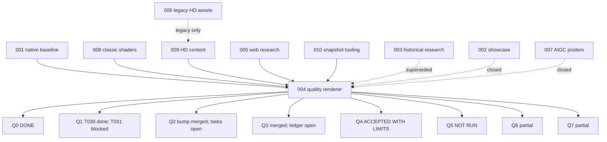

# DX12 RHI roadmap spec — live status

**Snapshot:** 2026-11-02T03:50Z
**main:** `e4ff6e9` (`fix(q1): treat a skipped debug layer as SKIPPED, not active (#123)`)
**Authoritative rules:** `AGENTS.md`, `docs/GIT_WORKFLOW.md`, `CONTRIBUTING.md`
**Execution log:** `docs/AGENT_MANAGER_CRON.md`

This file is a working roadmap, not the source of truth for acceptance. Task checkboxes and evidence
under `specs/004-quality-renderer/` decide what is actually done.

## 1. Status matrix

| Workstream | Status | Evidence / remaining gap |
|---|---|---|
| Q0 baseline | **DONE** | `evidence-q0.md`; T006–T011 checked |
| Q1a clear/readback | **DONE** | PR #18; T012–T021 checked |
| Q1b/Q1 RHI | **FIX MERGED, RE-REVIEW PENDING** | T030 checked on Graphics Tools host (#111); skipped-layer fix #123 merged `e4ff6e9`; T031 independent re-review pending |
| Q2 engine adapter | **BUMP MERGED, ACCEPTANCE OPEN** | #113 merged `8815239`; T034–T040, T080–T083 still unchecked |
| Q3 history/HUD | **MERGED, LEDGER OPEN** | #121 merged `08de566`; T044/T048/T085 still unchecked; review landed after merge (base-pin breach) |
| Q4 hybrid quality | **ACCEPTED WITH LIMITS** | T049–T057/T086/T090/T091 checked; review r3; VRAM 107,110,400 bytes |
| Q5 provider/DLSS | **NOT RUN** | T060–T062; no NVIDIA GPU/SDK (#105) |
| Q6 DXR | **PARTIAL** | T063–T068 checked; #118 merged captures `c63f57a`; T069 still partial, T070 not reviewed |
| Q7 WebGPU | **PARTIAL** | T071 checked; #119 merged `c4509cd`; T072–T075 still unchecked |
| 008 classic shaders | **PARTIAL / BLOCKED DATA** | #107 census; T-027/T-030 need retail content (#105) |
| 009 RHI HD content | **PARTIAL / BLOCKED CAPTURES** | 7 cells authored; retail/legal captures blocked (#105) |
| 001 native baseline | **MOSTLY DONE** | #112/#114 and #103/#109 fixes; T066b RoE needs retail data |

## 2. Gates

Last verified at `b7c1a68`:

```text
py -3 -I scripts/validate-rhi-contract.py --self-test   -> exit 0
py -3 -I scripts/validate-webgpu-mapping.py             -> exit 0
```

`#93` is closed by #115; if new RHI declarations are added, rerun both and update
`webgpu-mapping.md` in the same PR.

## 3. Hard blockers

| Blocker | Effect | Unblock |
|---|---|---|
| No NVIDIA GPU/SDK on host (AMD RX 9070 XT) | Q5 T060–T062 cannot run; DLSS 5 stays NOT RUN | NVIDIA RTX 50 + authorized SDK + legal clearance |
| No owned retail/legal game data | 008 T-027/T-030, 009 captures, Q2 T039, 001 T066b | owner-provided retail install or licensed source |
| Q1 skipped-layer bug | T031 red on hosts without `d3d12SDKLayers.dll` | fix `rhi_diagnostics_test.cpp` state logic; re-review |
| Q2/Q3 ledger drift | merged code but unchecked tasks | evidence-based reconciliation; no false ticks |

## 4. Dependency graph



## 5. Session plan (remaining executable work)

Historical S0–S4 are done; the remaining plan is:

| Session | Work | Depends | Status |
|---|---|---|---|
| **R0** | Q1 skipped-layer fix + T031 re-review | — | fix **MERGED** #123 `e4ff6e9`; T031 re-review pending |
| **R1** | Q2/Q3 ledger reconciliation | Q2 #113, Q3 #121 | **PR #124 open**; review pending |
| **R2** | Q6 T069/T070 evidence + review reconciliation | #118 | queued; only with evidence |
| **R3** | Q7 T072–T075 reconciliation | #119 | queued; T074 remains NOT RUN without data |
| **R4** | Final audit: close only proven issues, record blocked rows | R0–R3 | queued |
| **X1** | Q5 T060–T062 | NVIDIA GPU/SDK | **BLOCKED** |
| **X2** | 008 T-027/T-030, 009 captures | retail/legal data | **BLOCKED** |

**Session count:** 5 executable (R0–R4), 2 hard-blocked packages. Do not count Q5/008/009 as sessions
until the environment gates are met.

## 6. Wave order

```text
Wave A (now)
  R0 Q1 skipped-layer fix
  R1 Q2/Q3 ledger

Wave B (after R0/R1)
  R2 Q6 evidence/review
  R3 Q7 ledger/review

Wave C
  R4 final audit + issue disposition
```

Parallel limit: 4 active; one writer per file. Q6/Q7 sessions must not touch `src/renderer/rhi/**`
mapping files or each other.

## 7. Merge policy

- Independent non-author review at the current head, recorded in a PR comment with session ID and SHA.
- Head at merge equals reviewed SHA; merge base equals current `origin/main`.
- `MERGEABLE` / `CLEAN`, checks pass, clean main, merge-tree clean.
- Build-system changes: reviewer reruns build/tests and records evidence; no owner sign-off.
- Submodule bumps: human owner sign-off required in addition to independent review.
- No issue closing without explicit owner permission.
- Any commit/rebase/force-push/`origin/main` advance voids approvals; rebase and re-review.

## 8. Process debt

- **#104**: three PRs (#100/#101/#102) merged before independent review; remediation is tracked, not
  retroactively approved.
- **#121**: Q3 merged before its approval comment; content approved afterward, but the merge breached
  the base pin. Do not repeat; review before merge.
- Keep ledger ticks tied to evidence; stale checkboxes caused Q2/Q3 confusion.

## 9. Next actions

1. Land R0 and re-run Q1 T031 review; only then tick T031.
2. Land R1 and correct Q2/Q3 task states with evidence.
3. Reconcile Q6 T069/T070 and Q7 T072–T075 only with real captures/reviews; keep T074 NOT RUN.
4. Final audit R4: close only proven issues; record Q5/008/009 as environment-blocked.
5. Do not claim “all specs complete” while Q5 and retail-data gates are unmet.

## 10. References

- `specs/004-quality-renderer/tasks.md`, `quality-rubric.md`, `evidence-q*.md`, `review-q*.md`
- `specs/008-classic-shaders/`
- `specs/009-rhi-hd-content/`
- `specs/005-web-renderer/research.md`
- Issues #53, #62, #67, #68, #93, #98, #104, #105
