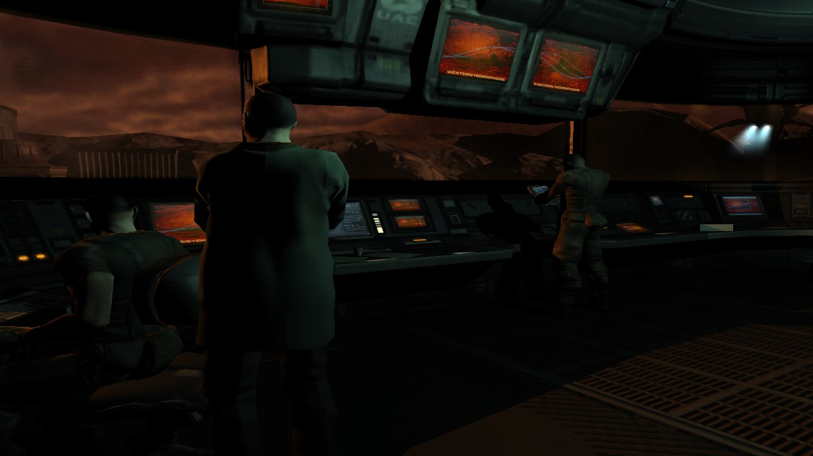
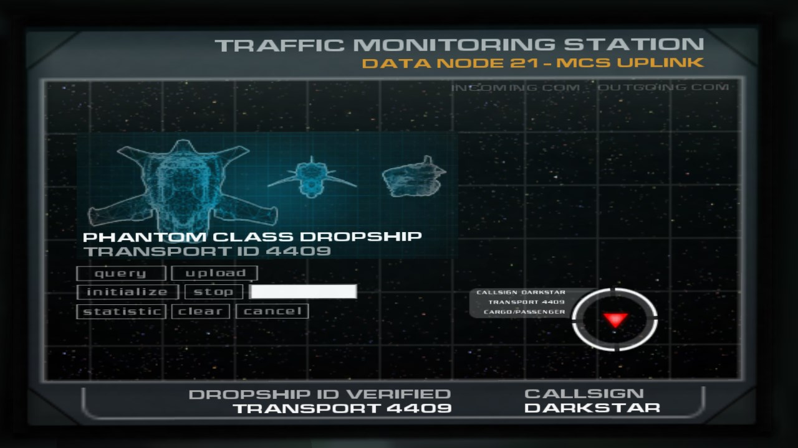
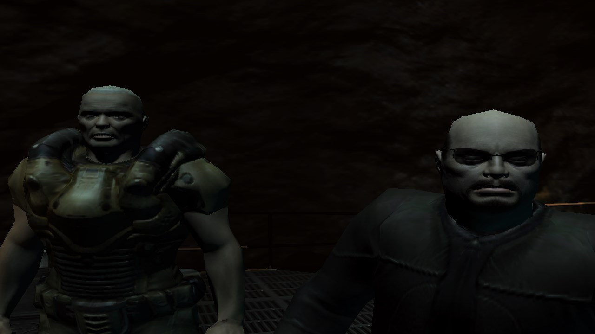
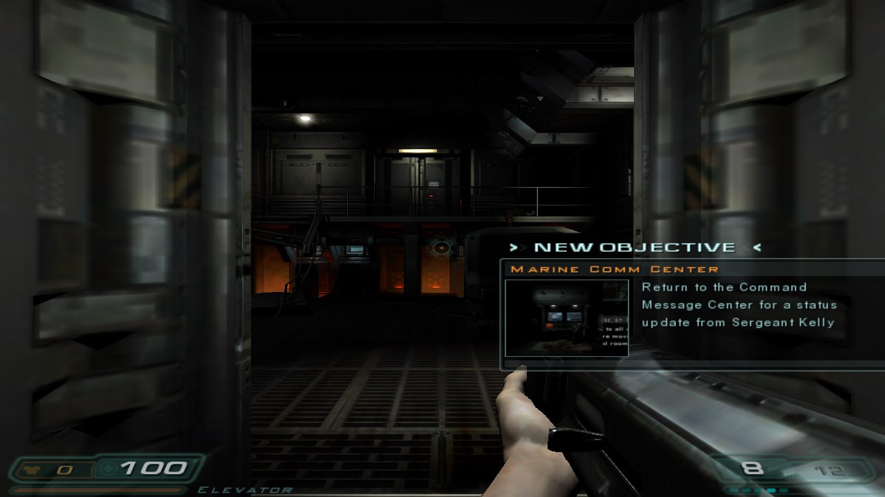
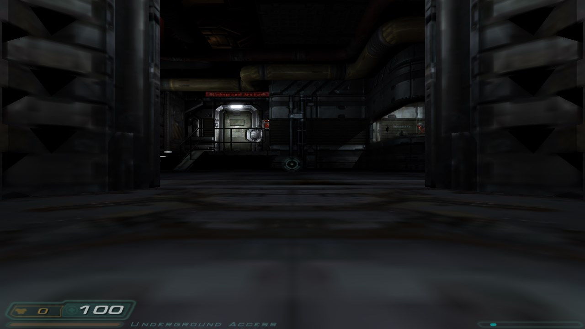
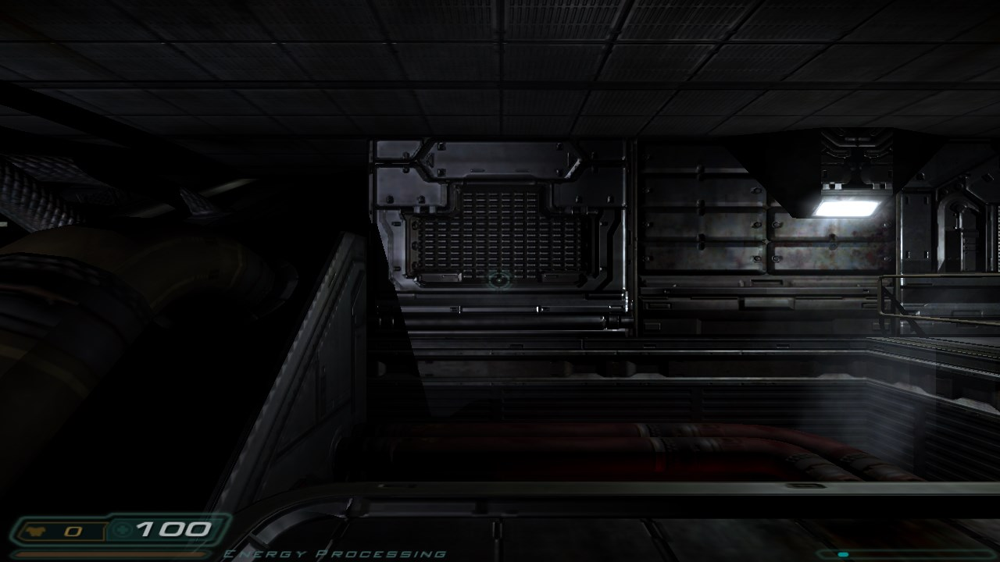

# DOOM3_AINative

**DOOM 3 running natively on Windows 11 x64, built from the 2011 GPL source — and a workspace for taking it to the web and making it moddable by AI agents.**



<sub>Frames below are real output of this repository's x64 build (`DOOM3.exe`, 1280×720) running the free official demo — captured by the engine's own `screenshot` command (`scripts/capture-showcase.ps1`).
<br><sub>Screenshots show artwork from the DOOM 3 demo, © id Software / ZeniMax Media, included here only to document this port's output. They are not covered by this repository's GPL licence; if you are a rights holder and object, open an issue and they will be removed.</sub>

| | |
|---|---|
|  |  |
| *Opening: the dropship briefing terminal* | *Cinematic: Sergeant Kelly's squad* |
|  |  |
| *In game: HUD and "New Objective" overlay* | *Mars City Underground: the hangar* |



## What works today

| | State |
|---|---|
| Native x64 build (VS2022, CMake, no MFC / DirectX SDK) | working, `DOOM3.exe` ≈ 16 MB |
| Main menu, 3D levels, cinematics, HUD, stencil shadows | working (OpenGL ARB2 path) |
| Sound | working (DirectSound stereo; verified audible) |
| Free demo levels: Mars City 1 / 2, Mars City Underground | load and run |
| Save games, demo recording/playback | pointer serialisation fixed (`SAVEGAME_VERSION` 18; older saves are rejected with a warning); save/load round trip and a demo record observed with the free demo — details in [`targets/win11-amd64/README.md`](targets/win11-amd64/README.md) |
| Multiplayer | a two-instance loopback join (listen server + `connect 127.0.0.1`) reached in-game and survived a map restart; real MP gameplay, x86 interop, >2 clients and internet play are **not** verified |
| `DOOM3XP.exe` (*Resurrection of Evil* game code, built by the same root build, statically linked) | builds, boots and runs the demo map; it needs the **retail** d3xp data (`d3xp/pak000.pk4`) to play the expansion and start it with `+set fs_game d3xp` (`run-win11-amd64.ps1` does that for you). **Retail RoE gameplay is unverified.** `DOOM3.exe` runs the base game only |
| Web (WebAssembly / WebGL2) port, AI modding layer | planned — [`docs/ROADMAP.md`](docs/ROADMAP.md) |

## Play it yourself

You need Windows 11, Visual Studio 2022 (C++ workload, Windows SDK 10.0.26100) and the **free** official
DOOM 3 demo installer (`D3Demo.exe`, id Software 2004 — licence: free non-commercial use, no modification or
redistribution). Game data is never stored in this repository.

```powershell
git clone --recurse-submodules <repo-url> DOOM3_AINative; cd DOOM3_AINative
cmake --preset win11-amd64                              # first run copies the pristine source and applies the x64 port (file list: targets/win11-amd64/patches/all-changes.manifest.txt; hash-verified)
cmake --build --preset win11-amd64-release              # -> build\bin\Release\DOOM3.exe
# extract demo00.pk4 from D3Demo.exe yourself, then:
.\scripts\prepare-demo-data.ps1 -Pk4 <path>\demo00.pk4 -RunDir <data-root>\run
.\scripts\run-win11-amd64.ps1 -DataDir <data-root>\run  # loads Mars City, takes a screenshot
.\scripts\verify-win11-amd64.ps1 -DataDir <data-root>\run   # 6 checks: PE, size, patches, menu+map smoke, audio
```

Notes: MSBuild switches passed after `--` must use a dash (`-- -m`, not `-- /m`): Git Bash rewrites `/m` into a path. New engine console commands for diagnosis: `sys_cpuInfo`, `sys_fpuState`, `sys_stackTrace`. Engine tests (each takes `-Exe -DataDir -OutDir`; the net test also `-Port`): `scripts/test-cpu-fpu-trace.ps1`, `test-savegame-demo.ps1`, `test-net-loopback.ps1`, `test-d3xp.ps1`. To run the expansion binary: `.\scripts\run-win11-amd64.ps1 -Exe build\bin\Release\DOOM3XP.exe -DataDir <data-root>\run` (adds `+set fs_game d3xp`; override with `-Game`).

Contributing (humans and AI agents): read [`CONTRIBUTING.md`](CONTRIBUTING.md) first.

## About this workspace

An AI-native workspace for migrating **DOOM 3** (idTech4, C++, OpenGL) to the web, and for running the
port as an agent-driven engineering loop: spec → worktree → PR → independent review → evidence.
The engine source is a pristine submodule; each migration target works on its own copy under `targets/`.
Milestones and exit criteria live in [`docs/ROADMAP.md`](docs/ROADMAP.md).
## What is in the box

| Path | Contents |
|---|---|
| `doom3_orig/doom3/` | **Pristine** git submodule — DOOM 3 GPL source (2011-11-22), GPLv3, **no game assets** |
| `doom3_orig/doc/` | Engine analysis notes (overview, platform, renderer, scripting, AI, build/deps) |
| `targets/<name>/doom3/` | One working **copy** per migration target (ignored scratch tree; see `targets/README.md`) |
| `.specify/` | GitHub spec-kit infrastructure (templates, PowerShell scripts, constitution) |
| `.kilo/command/` | `/speckit.*` slash commands (constitution, specify, clarify, plan, tasks, analyze, implement, converge, checklist, taskstoissues) |
| `.kilo/skills/` | 14 project-local skills (game dev, debugging, review, browser testing, C++→WASM) |
| `.claude/skills/` | Port know-how: `win64-port-playbook` (Windows x64 bring-up, debugging loop, bug catalogue) |
| `.kilo/setup-script.ps1` | Initialises the submodule in every Agent Manager worktree |
| `docs/` | Workflow, skills inventory, roadmap |
| `scripts/` | Worktree helpers, target copies, win11-amd64 build/verify/smoke/capture scripts, skill verifier |
| `targets/win11-amd64/` | CMake build, patch set and README for the native Windows 11 x64 port |
| `docs/media/` | Screenshots rendered by the x64 engine (see above) |

## Quick start

```powershell
# clone with the engine submodule
git clone --recurse-submodules <repo-url> DOOM3_AINative

# already cloned without it:
git submodule update --init --recursive

# create the working copy for a migration target (pristine stays untouched)
.\scripts\new-target.ps1 -Name web

# see how far a target has drifted from the pristine source
.\scripts\diff-target.ps1 -Name web

# verify the local skill install
powershell -NoProfile -ExecutionPolicy Bypass -File scripts\verify-skills.ps1

# spec-kit (no global install needed)
uvx --from git+https://github.com/github/spec-kit.git specify check
```

Open the repo in Kilo and start with `/speckit.constitution`, then `/speckit.specify`.

## Workflow in one paragraph

One issue = one branch = one worktree = one PR. A coordinator breaks the issue down and owns
integration; each worker gets one worktree under `.kilo/worktrees/` and one ticket; a reviewer who
did not write the code runs the `code-review` skill against the PR. Only squash merges into
`main`, and the PR body must carry the evidence (command + output) that the change works. Full
mechanics, scripts, and red lines: [`docs/GIT_WORKFLOW.md`](docs/GIT_WORKFLOW.md).

## Skills

The project ships real copies of the skills it depends on, so a fresh worktree or a CI agent gets
the same behaviour without the user's global vault. Each skill is a directory with a `SKILL.md`.

- Migration: `cross-platform-guide`, `wasm-emscripten`, `win64-port-playbook` (in `.claude/skills`)
- Game loop: `game-dev-loop`, `game-gdd-writing`, `game-build-verification`, `game-debug`
- Engineering: `software-dev-loop`, `tdd`, `systematic-debugging`, `code-review`, `prompt-pro`
- Verification and delivery: `verification-before-completion`, `webapp-testing`, `using-git-worktrees`

Provenance, pinned commits, and the "deliberately not installed" list are in
[`docs/SKILLS.md`](docs/SKILLS.md).

## Engine submodule and target copies

`doom3_orig/doom3/` is a pristine clone of a fork of `id-Software/DOOM-3`; it is pinned by commit
and treated as read-only evidence. Engine changes are made on a fork branch, never as unexplained
working-tree dirt here; this repository only records submodule bumps.

Migration work happens in `targets/<name>/doom3/`, a plain copy created by
`scripts/new-target.ps1` with no shared git metadata. Each target gets exactly one copy, so ports
cannot leak into each other; `scripts/diff-target.ps1` shows the divergence from pristine. The
source release has no game data — `.pk4`/`.pk3`/`.pak` files are ignored and must not be committed.

## Licensing

This repository's own content — specs, docs, scripts, workflow, automation — is
**GPL-3.0-or-later** ([`LICENSE`](LICENSE)), matching the engine's licence so the port stays a
single, compatible work.

- Engine source in `doom3_orig/doom3/`: GPLv3 or later (`doom3_orig/doom3/COPYING.txt`).
- Game data: not included, still governed by the original DOOM 3 EULA
  (`doom3_orig/doom3/README.txt`).
- Spec Kit, MIT and Apache-2.0 skills: their own licences, recorded in
  [`THIRD_PARTY_NOTICES.md`](THIRD_PARTY_NOTICES.md) and `docs/SKILLS.md`.

SPDX identifier for this repository: `GPL-3.0-or-later`.
