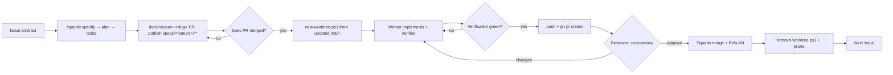

# Git Workflow — issue → worktree → PR

Operating guide for a coordinator agent and parallel worker agents on Windows.
Verified 2026-10-26: PowerShell 5.1, git 2.25.0, `gh` 2.100.0 found on `PATH` and
authenticated. Every command below is copy-pasteable; PowerShell 5.1 has **no `&&`**.

## 0. Bootstrap (once, before the loop works)

The worktree scripts need one commit on `main` and an `origin` remote. If either is missing,
the owner bootstraps once — do not let a worker improvise it. Run this from the repo root.

```powershell
git status --short                  # review every path before staging
gh auth status                      # must show an active account with repo scope
git log --oneline -1                # must succeed
git remote -v                       # must show origin
```

Create `main` and `origin` once (owner, after reviewing what is tracked):

```powershell
git add <reviewed paths>
git commit -m "chore: initial import"
gh repo create DOOM3_AINative --private --source . --remote origin --push
```

Keep worktree checkouts out of `git status`. The repo `.gitignore` should already contain
`.kilo/worktrees/`; otherwise use a local-only exclude:

```powershell
git check-ignore -q .kilo/worktrees; if (-not $?) { Add-Content .git\info\exclude ".kilo/worktrees/" }
```

## 1. Model

- One issue = one spec PR (`docs/`) plus one implementation branch, worktree and PR (`feat/`,
  `fix/`, `chore/`). No multi-issue branches; no second implementation branch for the same issue.
- Trunk-based: `main` is protected and always releasable; branches are short-lived (target < 2 days).
- Worktrees live in `.kilo/worktrees/<slug>`; slug is the branch name with `/` → `-`
  (`feat/42-webgl-audio` → `.kilo/worktrees/feat-42-webgl-audio`).
- Branch names: `feat/<issue>-<slug>`, `fix/<issue>-<slug>`, `chore/<issue>-<slug>`,
  `docs/<issue>-<slug>`. Slug is lowercase kebab-case, ≤ 40 chars.
- Specification artifacts come from spec-kit: `/speckit.specify` → `/speckit.plan` →
  `/speckit.tasks`, with `/speckit.clarify`, `/speckit.analyze`, `/speckit.checklist`
  as optional gates. `/speckit.taskstoissues` turns `tasks.md` into the issue set.
- A specification is published by a `docs/<issue>-<slug>` PR — one PR may carry more than one
  spec, as `docs/10-publish-renderer-specs` did for 003 and 004. `spec.md`, `plan.md` and
  `tasks.md` merge to `main` **before** `scripts/new-worktree.ps1` creates the implementation
  worktree, so the worktree starts from a main that already holds the design it implements.
  The spec PR is reviewed like any other PR; its reviewer checks the design against the issue
  contract, not the code.
- Specs 001, 002, 006 and 007 predate that rule and landed inside their implementation PRs.
  That history is a fact to record, not a route to copy.
- Two integrations are installed and both drive the same `.specify/scripts/powershell/*.ps1`:
  `generic` writes `.kilo/command/speckit.*.md` (Kilo, `/speckit.specify`), `claude` writes
  `.claude/skills/speckit-*/SKILL.md` (Claude Code, `/speckit-specify`). `generic` stays the
  default; installing or updating the Claude side does not touch the Kilo commands.

## 2. Roles and handoff artifacts

| Role | Owns | Never does |
|---|---|---|
| Coordinator | issue breakdown, spec-kit flow, file-ownership map, integration, submodule bump | implement a worker ticket in the same worktree |
| Worker | exactly one worktree and one issue: implement + prove + PR; may merge after independent review per `AGENTS.md` §11 | touch another worker's paths, review own work, merge without independent approval |
| Reviewer | independent adversarial review of the PR diff; records `APPROVED` or blocking findings | be the author or share the author's worktree/session |

Handoffs are files/artifacts, not chat:

1. **Issue brief** — the contract in §3, written by the coordinator before the implementation branch
   exists. It is the input to `/speckit.specify`, not the spec itself.
2. **Spec PR** — `docs/<issue>-<slug>` carrying `specs/<feature>/`; merged to `main` before the
   worktree is created. The implementation branch uses a different prefix (`feat/`, `fix/`,
   `chore/`) and starts from a `main` that already contains the spec.
3. **Branch** — created by `scripts/new-worktree.ps1` from the updated `main`; body of work ends with `git push -u origin <branch>`.
4. **PR body** — §8 template: `Refs #N` (never `Closes #N` without the user's approval), evidence block, risk/rollback. Draft until verification passes.
5. **Verification log** — exact commands, exit codes, counts, screenshot paths, pasted into the PR body.
   Machine-specific artifacts stay untracked; the log is text.

## 3. Issue contract (coordinator writes this, verbatim into the issue)

```markdown
Title: <verb> <object> (<area>)
Context: links to spec.md / plan.md / prior PRs; why now
Acceptance criteria (checkable, one per line):
- [ ] `<build/test command>` exits 0
- [ ] `build/foo.js` exists and is > 1024 bytes
- [ ] screenshot at 1280x720 shows <specific visible state>
In scope: paths the PR may touch (exact directories/files)
Out of scope: paths that must stay untouched
Verification command: the one command the reviewer reruns
Blocking edges: #<issue> (must merge first) | none
Agent hint: model/tooling notes, port, build dir, expected duration
```

No acceptance criterion without a command, exit code, byte count, file listing, or screenshot.
If it cannot be checked mechanically, rewrite it until it can.

## 4. Worktree lifecycle

```powershell
# 1. create (fetches origin, branches from origin/main, initialises doom3_orig/doom3/)
.\scripts\new-worktree.ps1 -Issue 42 -Slug webgl-audio -Kind feat

# 2. enter and confirm isolation
cd .kilo\worktrees\feat-42-webgl-audio
git submodule update --init --recursive
git status --short
git rev-parse --show-toplevel

# 3. work, verify (issue's verification command), then commit
git add <only owned paths>
git commit -m "feat(audio): route WebAudio through SDL shim (#42)"

# 4. publish
git push -u origin feat/42-webgl-audio
gh pr create --draft --base main --title "feat(audio): WebAudio shim (#42)" --body-file "$env:TEMP\pr-42.md"

# 5. review (reviewer, never the author): load the code-review skill, fixed point origin/main
gh pr ready 42

# 6. merge (author or coordinator, after independent review), squash only
gh pr merge 42 --squash

# 7. cleanup from the parent checkout (script = git worktree remove + prune)
.\scripts\list-worktrees.ps1
.\scripts\remove-worktree.ps1 -Path .kilo\worktrees\feat-42-webgl-audio
git worktree prune
```

`new-worktree.ps1` exits `2` if the worktree exists but the submodule clone failed; fix with
`git -C <path> submodule update --init --recursive`, do not delete the worktree.
`gh pr create --body-file` works in PowerShell; avoid inline multi-line `--body`.
`gh pr merge <n> --squash` — do **not** pass `--delete-branch` while the worktree still
exists; let `remove-worktree.ps1` delete the local branch after merge.
git 2.25 cannot `worktree remove` a checkout that contains submodules. The script therefore
verifies the tree (including untracked files inside `doom3_orig/doom3/`) is clean, then retries with
`--force --force`. `-Force` skips that guard and discards uncommitted work.

## 5. Parallelism rules

- Maximum 3–4 concurrent workers per machine (IO, GPU, and review bandwidth bound).
- Stabilise shared contracts (headers, interfaces, schemas, file layout) on `main` first,
  then split. Never let two workers discover the same interface independently.
- One branch, one worktree, one writer. Split by **file ownership**, not by task name.
- Never `git stash` — stashes are shared across worktrees and silently corrupt other work.
- Derive ports and build dirs from `WORKTREE_PATH`; never reuse a fixed build dir.

Example split for the current milestone (replace paths with the real ones before dispatch):

| Worker | Issue | Owns (write) | Reads only | Port | Build dir |
|---|---|---|---|---|---|
| w1 | #42 | `src/audio/**` | `doom3_orig/doom3/neo/sound/**` | 27701 | `build/` |
| w2 | #43 | `src/render/**` | `doom3_orig/doom3/neo/renderer/**` | 27702 | `build/` |
| w3 | #44 | `docs/**`, `scripts/**` | everything | — | — |

```powershell
$env:WORKTREE_PATH = (git rev-parse --show-toplevel)
$sha = [System.Security.Cryptography.SHA256]::Create()
$bytes = $sha.ComputeHash([System.Text.Encoding]::UTF8.GetBytes($env:WORKTREE_PATH.ToLowerInvariant()))
$sha.Dispose()
$env:D3_PORT = 27700 + ((($bytes[0] -shl 8) + $bytes[1]) % 100)
$env:D3_BUILD = Join-Path $env:WORKTREE_PATH 'build'
```

## 6. DOOM 3 specifics

- `doom3_orig/doom3/` is a **pristine** submodule (GPLv3 source only). Treat it as read-only: no
  formatting, no builds, no edits in place.
- Migration work happens in `targets/<name>/doom3/`, one copy per target, created with
  `.\scripts\new-target.ps1 -Name <target>` (no shared git metadata; the copy is git-ignored).
  Inspect divergence with `.\scripts\diff-target.ps1 -Name <target>`. A worker owns exactly one
  target copy and never edits another target's copy.
- A change that must live in the engine itself is made **on a branch of the fork**
  `yhyu13/DOOM-3`, pushed there, and landed on `main` here as a submodule bump:
  `git add doom3_orig/doom3` in the superproject, commit message
  `chore(doom3): bump to <sha>`, PR body carries the fork PR URL and the old/new SHA. Never commit
  submodule changes ad hoc, and never let fork work exist only inside a target copy.
- A submodule bump PR requires one independent reviewer (build-system changes do too).
- Game assets (`.pk4`/`.pk3`/`.pak`), binaries, object files, and `build/` stay out of git.
  The source release ships no data; do not add it.
- `git submodule update --init` inside each worktree creates a **per-worktree** submodule
  checkout. That is isolated but costs another clone; initialise only worktrees that touch the
  pristine source, and expect disk/network time. Recreate target copies inside a worktree with
  `new-target.ps1`; never copy them between worktrees.
- A worktree whose submodule is detached is normal; branch inside `doom3_orig/doom3/` explicitly
  before editing — but prefer a fork branch plus a bump over a detached local commit.

## 7. Conflict and failure protocol

1. Before requesting review: `git fetch origin` then `git rebase origin/main` **inside the worktree**.
2. Resolve conflicts there, re-run the issue's verification command, then force-push only your own
   branch: `git push --force-with-lease`. Never force-push `main`.
3. Verification fails → PR stays **draft**, evidence block records the failing command and exit code.
   Fix or close; do not merge "mostly green".
4. Integration failure after merge → `git revert <sha>` on `main` via a new PR. No history rewrite.
5. Blocked > 1 day on another issue → coordinator re-slices the issue; do not widen scope silently.

## 8. Merge policy

- Squash merge only. PR body must contain `Refs #N`, the evidence block, and risk/rollback.
- Never close an issue on your own: no `gh issue close`, and no `Closes`/`Fixes`/`Resolves #N`
  in the PR body or commit message unless the user approved closing that issue. The user closes
  the issue after checking the result.
- Every PR gets an **independent** review (never the author, never a reviewer sharing the author's
  worktree or session). The author may merge their own PR after that review; see `AGENTS.md` §11.
  `doom3_orig/doom3/` submodule bumps and build-system changes also require an independent reviewer
  who reruns the verification command.
- Reviewer runs the `code-review` skill pinned at `origin/main...HEAD`; comments cite file:line.
- Merge only when: CI/verification green, independent review approved with the reviewed SHA,
  `MERGEABLE` / `CLEAN` against current `origin/main`, clean main worktree, no out-of-scope paths,
  no uncommitted submodule dirt, PR body complete.

```markdown
## Evidence
- `cmd` → exit 0, <key output line>
- artifact: `build/foo.js` 41,233 bytes
- screenshot: <path or URL>

## Risk / rollback
Risk: <what breaks if wrong>
Rollback: revert this squash commit on main; no data migration
Refs #42
```

## 9. Loop



## 10. Red lines and checklist

Red lines (max 10, no exceptions):

1. No direct commits to `main`; no force-push to `main`.
2. One issue per branch; never two agents on one branch or one worktree.
3. Never `git stash`.
4. Never commit game assets, binaries, or build output.
5. Never edit `doom3_orig/doom3/` without a fork branch and a recorded submodule bump.
6. Never merge with red verification; draft PRs stay draft.
7. Never write outside the issue's in-scope paths.
8. Never let a reviewer review their own diff.
9. Never commit secrets, tokens, or absolute machine paths.
10. Never delete another worker's worktree or branch.

Start (per worker):

- [ ] Issue contract read; acceptance criteria checkable; blocking edges merged.
- [ ] Spec PR merged to `main` (`git log --oneline -1 origin/main` shows the spec commit).
- [ ] `git log --oneline -1 origin/main` succeeds; ownership table row assigned.
- [ ] `new-worktree.ps1` printed path + branch; `git status` clean; submodule initialised if needed.
- [ ] Ports/build dirs derived from `WORKTREE_PATH`.

Finish (before merge):

- [ ] Verification command rerun in the worktree, output pasted into the PR body.
- [ ] `git fetch origin` + rebase done; `git status` clean; no submodule dirt.
- [ ] PR has `Refs #N` (no closing keyword unless approved), evidence, risk/rollback; reviewer approved.
- [ ] After merge: `remove-worktree.ps1`, then `git worktree prune`; branch deleted only if merged.
