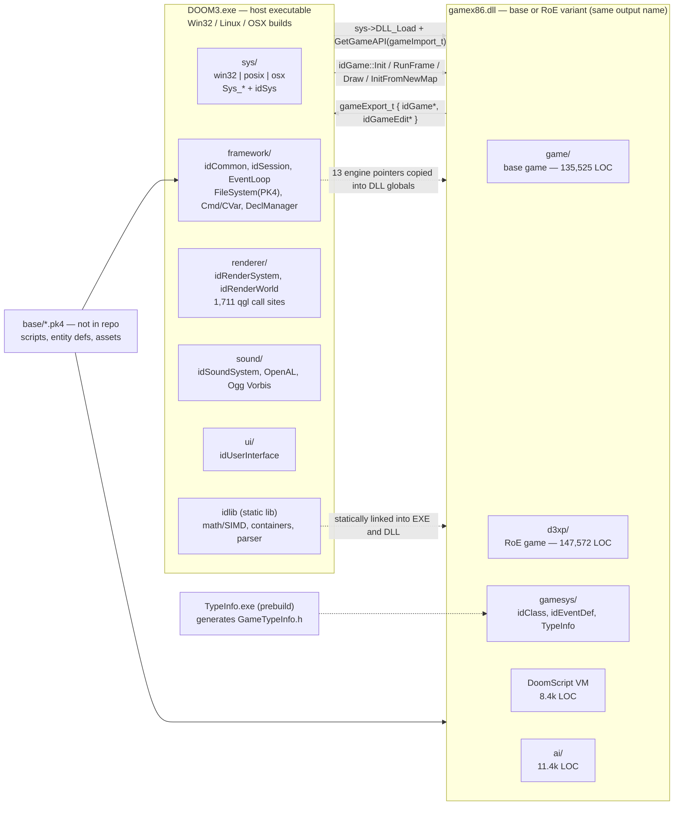

# 00 — Overview & Metrics (DOOM 3 GPL, idTech4)

**Scope.** Read-only quantitative survey of `doom3_orig/doom3/neo` at the checked-out submodule
commit `a9c49da` (the 2011-11-22 GPL source release). Measured 2026-10-26 with
ripgrep 15.1.0 and Windows PowerShell 5.1. All size, marker, event, and
interface tables below were produced by the script in Appendix A; global-state
and blocker/opportunity rows combine that output with the cited `rg` patterns.
No figure was derived by hand.

**Purpose.** Establish a baseline for two connected goals:

1. **Easy code migration** — move the engine and game to a portable target
   (web/WASM or another platform) with measurable effort, by locating the native
   coupling that must be replaced and the interfaces that can stay stable.
2. **AI modding** — make game state, events, classes, and behaviors legible and
   controllable by agents. The preferred end state is data/script-level modding
   (DoomScript, entity definitions, cvars/commands, event injection) that does
   not require changing engine C++ for every mod.

Sibling documents: `01_engine_core_platform.md`, `02_renderer.md`,
`03_scripting_and_modding.md`, `04_game_logic_and_ai.md`,
`05_build_deps_data_tools.md`.

---

## 1. Headline findings

| Finding | Value | Consequence |
|---|---:|---|
| Source size | **1,387 files, 863,307 physical LOC** (733 `.cpp`/`.c`, 654 `.h`) | Large but tractable; engine + game are 569,056 LOC (65.9%). |
| Deferrable surface | **290,600 LOC (33.7%)** in `tools/` + vendored code | A runtime-only port can postpone editor, curl, OpenAL, Ogg Vorbis, and JPEG work. |
| Game code duplication | **`game/` 135,525 LOC vs `d3xp/` 147,572 LOC**; 135 shared relative paths, 72 byte-identical | Base game and RoE are near-duplicates; migration and AI prompts must handle both or unify them. |
| Native x86 assembly | **1,554 first-party `__asm` occurrences**; 1,433 in `idlib/math/Simd_SSE.cpp` | The SIMD math layer is the single densest portability hazard. |
| OpenGL surface | **2,843 `qgl*` call sites**; 1,711 in `renderer/` | Rendering must be re-targeted to WebGL2/GLES or a GL compatibility layer. |
| OS seam | **1,305 `Sys_*` call sites**; Win32 window/input/audio in `sys/win32` | The seam exists, but its Win32 implementation is substantial and synchronous. |
| Module boundary | **13 engine pointers imported into each game DLL**; `idGame` + `idGameEdit` have 96 virtuals (40 pure) | The exe↔DLL ABI is C++ vtable-based, not a stable C ABI. |
| Mutable global state | **7,168 engine-singleton dereferences + 7,301 `gameLocal.` references** | Multi-instance, snapshot, and sandbox work all pass through global roots. |
| Event catalog | **478 base / 540 RoE `idEventDef` definitions**; 1,134/1,290 `EV_*` references | A ready-made, named, typed action vocabulary for tooling and agents. |
| Reflection | **295 `CLASS_DECLARATION` macros**, 175 `idTypeInfo` references, generated `GameTypeInfo.h` | Class/field metadata already exists and can be exported as a schema. |
| Public interfaces | **23 interface classes / 560 virtual methods** across 16 engine API headers | Clear seams for adapters, mocks, tracing, and replacement backends. |

Counts are lexical (comments and strings included unless stated). “First-party”
excludes `curl/`, `openal/`, `sound/OggVorbis/`, `renderer/jpeg-6/`,
`renderer/glext.h`, and `renderer/wglext.h`.

---

## 2. Size and layout

LOC is physical lines including blank lines and comments. The `.cpp/.c` column
combines 563 `.cpp` and 170 `.c` files; there are no `.hpp` or `.inl` files in
this tree.

| Directory | Role | .cpp/.c | .h | .cpp/.c LOC | .h LOC | Total LOC | Share |
|---|---|---:|---:|---:|---:|---:|---:|
| `tools/` | editor, map compilers, debugger | 204 | 177 | 127,091 | 20,873 | 147,964 | 17.1% |
| `d3xp/` | RoE game DLL variant | 73 | 66 | 129,857 | 17,715 | 147,572 | 17.1% |
| `game/` | base game DLL | 71 | 64 | 119,339 | 16,186 | 135,525 | 15.7% |
| `idlib/` | containers, math, parser, SIMD | 52 | 68 | 74,734 | 25,438 | 100,172 | 11.6% |
| `renderer/` | OpenGL renderer | 108 | 37 | 80,798 | 18,256 | 99,054 | 11.5% |
| `sound/` | mixer + Ogg Vorbis | 35 | 46 | 26,447 | 39,196 | 65,643 | 7.6% |
| `curl/` | vendored HTTP client | 90 | 75 | 38,924 | 8,216 | 47,140 | 5.5% |
| `framework/` | common, session, FS, decls | 29 | 33 | 41,414 | 5,579 | 46,993 | 5.4% |
| `sys/` | OS/platform layer | 38 | 41 | 22,434 | 9,809 | 32,243 | 3.7% |
| `ui/` | GUI / user interface | 20 | 24 | 15,189 | 4,143 | 19,332 | 2.2% |
| `cm/` | collision model | 8 | 2 | 8,583 | 675 | 9,258 | 1.1% |
| `openal/` | vendored OpenAL headers | 2 | 18 | 293 | 6,994 | 7,287 | 0.8% |
| `MayaImport/` | Maya exporter plugin | 1 | 2 | 3,149 | 502 | 3,651 | 0.4% |
| `TypeInfo/` | type-info codegen | 2 | 1 | 1,357 | 116 | 1,473 | 0.2% |
| **Total** | | **733** | **654** | **689,609** | **173,698** | **863,307** | **100%** |

Disjoint ownership split used in the headline table:

| Category | Files | LOC | Share |
|---|---:|---:|---:|
| `game/` + `d3xp/` game variants | 274 | 283,097 | 32.8% |
| Engine/runtime core (everything else except tools, Maya, vendor) | 409 | 285,959 | 33.1% |
| `tools/` | 381 | 147,964 | 17.1% |
| Vendored/third-party code | 320 | 142,636 | 16.5% |
| `MayaImport/` | 3 | 3,651 | 0.4% |

### 2.1 Top 25 largest files

| # | File | Lines | Bytes | Role |
|---:|---|---:|---:|---|
| 1 | `sound/OggVorbis/vorbissrc/books/coupled/res_books_stereo.h` | 19,080 | 595,559 | vendored/generated Vorbis tables |
| 2 | `idlib/math/Simd_SSE.cpp` | 18,087 | 491,970 | first-party runtime |
| 3 | `idlib/math/Simd_AltiVec.cpp` | 11,239 | 389,152 | PPC AltiVec path |
| 4 | `sound/OggVorbis/vorbissrc/books/uncoupled/res_books_uncoupled.h` | 10,907 | 264,702 | vendored/generated Vorbis tables |
| 5 | `d3xp/Player.cpp` | 10,119 | 274,278 | RoE game |
| 6 | `game/Player.cpp` | 8,521 | 230,396 | base game |
| 7 | `idlib/math/Matrix.cpp` | 8,102 | 257,900 | first-party runtime |
| 8 | `d3xp/physics/Physics_AF.cpp` | 8,007 | 209,643 | RoE game |
| 9 | `game/physics/Physics_AF.cpp` | 8,006 | 209,641 | base game |
| 10 | `tools/radiant/MainFrm.cpp` | 6,902 | 252,455 | editor/tool |
| 11 | `renderer/glext.h` | 5,919 | 308,921 | generated OpenGL extension header |
| 12 | `d3xp/Entity.cpp` | 5,602 | 143,990 | RoE game |
| 13 | `game/Entity.cpp` | 5,390 | 138,799 | base game |
| 14 | `d3xp/ai/AI.cpp` | 5,354 | 149,062 | RoE game |
| 15 | `tools/radiant/EditorBrush.cpp` | 5,220 | 128,470 | editor/tool |
| 16 | `d3xp/anim/Anim_Blend.cpp` | 5,108 | 128,511 | RoE game |
| 17 | `game/ai/AI.cpp` | 5,106 | 142,754 | base game |
| 18 | `game/anim/Anim_Blend.cpp` | 5,022 | 126,020 | base game |
| 19 | `d3xp/Game_local.cpp` | 4,986 | 130,779 | RoE game |
| 20 | `d3xp/Mover.cpp` | 4,693 | 118,119 | RoE game |
| 21 | `game/Mover.cpp` | 4,632 | 116,499 | base game |
| 22 | `tools/radiant/XYWnd.cpp` | 4,569 | 138,906 | editor/tool |
| 23 | `framework/Unzip.cpp` | 4,470 | 157,763 | first-party runtime |
| 24 | `tools/radiant/PMESH.CPP` | 4,461 | 118,856 | editor/tool |
| 25 | `d3xp/MultiplayerGame.cpp` | 4,385 | 132,128 | RoE game |

The largest files are not representative of difficulty: the two Vorbis table
headers and `glext.h` are generated; the two `Player.cpp` and `Physics_AF.cpp`
pairs are near-duplicates across `game/` and `d3xp/`.

---

## 3. Platform-coupling markers by directory

### 3.1 Preprocessor and assembly markers

Counts are occurrences of the literal token, including comments and inactive
`#if` branches. `#pragma` counts lines beginning with the directive.

| Directory | `_WIN32` | `__linux__` | `MACOS_X` | `_MSC_VER` | `__asm` | `#pragma` |
|---|---:|---:|---:|---:|---:|---:|
| `cm/` | 0 | 0 | 0 | 0 | 0 | 8 |
| `curl/` | 9 | 0 | 0 | 7 | 0 | 11 |
| `d3xp/` | 1 | 1 | 0 | 0 | 0 | 76 |
| `framework/` | 12 | 3 | 11 | 0 | 0 | 29 |
| `game/` | 1 | 1 | 0 | 0 | 0 | 74 |
| `idlib/` | 38 | 6 | 25 | 0 | 1,529 | 55 |
| `MayaImport/` | 0 | 0 | 0 | 0 | 0 | 1 |
| `openal/` | 4 | 0 | 0 | 0 | 0 | 18 |
| `renderer/` | 9 | 3 | 25 | 0 | 0 | 57 |
| `sound/` | 5 | 0 | 4 | 0 | 4 | 16 |
| `sys/` | 6 | 3 | 5 | 0 | 25 | 37 |
| `tools/` | 2 | 1 | 0 | 95 | 0 | 295 |
| `TypeInfo/` | 1 | 0 | 0 | 0 | 0 | 2 |
| `ui/` | 0 | 0 | 0 | 0 | 0 | 20 |
| **Total** | **88** | **18** | **70** | **102** | **1,558** | **699** |

Key concentration: 1,529 of 1,558 `__asm` occurrences are in `idlib/`, and 1,433
of those are in the single file `idlib/math/Simd_SSE.cpp`.

### 3.2 API and mutable-state markers

`qgl*` and raw `gl*` counts are call-like occurrences in `.cpp/.c` only, so
header declarations are excluded. `Sys_*` counts include both calls and
definitions. `extern` excludes `extern "C"`. “Static mutable” is a heuristic:
file-scope `static` lines that are not `const`/`inline` and do not contain `(`.
It is deliberately conservative and still count-heavy because of vendored tables.

| Directory | qgl* calls | raw gl* calls | Sys_* calls | extern lines | static mutable | virtual |
|---|---:|---:|---:|---:|---:|---:|
| `cm/` | 0 | 0 | 0 | 2 | 14 | 21 |
| `curl/` | 0 | 0 | 0 | 18 | 131 | 1 |
| `d3xp/` | 0 | 0 | 0 | 390 | 83 | 822 |
| `framework/` | 0 | 0 | 237 | 94 | 116 | 652 |
| `game/` | 0 | 0 | 0 | 354 | 79 | 755 |
| `idlib/` | 0 | 0 | 0 | 39 | 53 | 427 |
| `MayaImport/` | 0 | 0 | 0 | 0 | 0 | 0 |
| `openal/` | 0 | 0 | 0 | 37 | 0 | 0 |
| `renderer/` | 1,711 | 9 | 21 | 784 | 198 | 477 |
| `sound/` | 0 | 0 | 45 | 233 | 3,058 | 158 |
| `sys/` | 10 | 337 | 564 | 69 | 145 | 56 |
| `tools/` | 1,122 | 93 | 417 | 81 | 163 | 598 |
| `TypeInfo/` | 0 | 0 | 19 | 0 | 1 | 29 |
| `ui/` | 0 | 0 | 2 | 4 | 42 | 347 |
| **Total** | **2,843** | **439** | **1,305** | **2,105** | **4,083** | **4,343** |

Important qualifications:

- The 337 raw `gl*` matches in `sys/` are almost entirely no-op stubs in
  `sys/stub/stub_gl.cpp` for the dedicated server, plus GL logging in
  `sys/win32/win_qgl.cpp`; the runtime renderer itself has only 9 raw `gl*`
  call sites and 1,711 `qgl*` call sites.
- 3,058 of the 4,083 “static mutable” lines are in `sound/`, overwhelmingly
  generated Ogg Vorbis codebooks; the first-party count is 927.
- Excluding vendored code, the totals become: `__asm` 1,554; `qgl*` 2,845 (headers included);
  `#pragma` 666; `extern` 1,733; static-mutable 927; `virtual` 4,252.

---

## 4. Event definitions (`idEventDef`)

The source spells idTech4 event definitions `EV_*`; the `EVENT_*` spelling is a
separate `idEntity::EVENT_*` enum used for network events, not an
`idEventDef` name. Both are counted below.

| Metric | `game/` (base) | `d3xp/` (RoE) |
|---|---:|---:|
| `const idEventDef` definitions | **478** | **540** |
| …with `EV_*` name | 320 | 375 |
| …with non-`EV_` name (`AI_*`, etc.) | 158 | 165 |
| `extern const idEventDef` declarations | 117 | 123 |
| `EV_*` references (all uses) | 1,134 | 1,290 |
| Unique `EV_*` names | 324 | 379 |
| Files containing definitions | 22 | 22 |
| Separate `EVENT_*` enum references | 81 | 96 |
| Unique `EVENT_*` names | 21 | 26 |

Interpretation: each game variant already carries a large, named action
vocabulary with argument-format strings (`Event.h:39-46`). The `EVENT_*` enum is
a second, much smaller network-event vocabulary; it must not be conflated with
the `idEventDef` event table when building tooling.

The literal `idEventDef(` syntax occurs only twice per variant: the constructor
declaration and definition (`Event.h:69`, `gamesys/Event.cpp:60`). Event
instances are declared `const idEventDef Name(...)`, which is why they are
counted by the first row rather than by a search for `idEventDef(`.

---

## 5. Global and static mutable state

### 5.1 Known engine singletons

`Derefs` counts `symbol->` (or `gameLocal.` for the object) across `.cpp/.h`.
Files are distinct files containing at least one dereference.

| Symbol | Derefs | Files |
|---|---:|---:|
| `gameLocal` | 7,301 | 139 |
| `common` | 3,451 | 253 |
| `declManager` | 796 | 131 |
| `cmdSystem` | 580 | 50 |
| `cvarSystem` | 564 | 69 |
| `fileSystem` | 552 | 103 |
| `session` | 334 | 39 |
| `renderSystem` | 225 | 31 |
| `gameEdit` | 182 | 34 |
| `renderModelManager` | 122 | 48 |
| `collisionModelManager` | 103 | 24 |
| `uiManager` | 88 | 27 |
| `networkSystem` | 78 | 12 |
| `soundSystem` | 62 | 17 |
| `eventLoop` | 27 | 11 |
| `AASFileManager` | 4 | 2 |

Aggregate heuristics:

| Heuristic | All code | First-party only |
|---|---:|---:|
| `extern` declaration lines (excluding `extern "C"`) | 2,105 | 1,733 |
| Non-const file-scope `static` lines (heuristic) | 4,083 | 927 |
| Engine-singleton dereferences (`common`, `renderSystem`, …) | 7,168 | — |
| `gameLocal.` dereferences | 7,301 | — |
| Engine pointers redefined as NULL in each game DLL | 13 per variant | — |
| Pointer definitions matched by the import/export pattern | 47 | — |

The module boundary makes this worse: `game/Game_local.cpp:36-48` (and the
`d3xp/` twin) re-declares 13 engine pointers inside the DLL, then copies the
engine’s values into them. `game/Game_local.cpp:64-65` defines `gameLocal` and a
`game` pointer, so the engine and game each have their own global root.

---

## 6. Virtual interfaces in public headers

There are **no `*_public/` directories** in this tree. There are four
`*_public.h` files, and only `sys/sys_public.h` contains virtual methods:

| Metric | Literal `*_public.h` | Broader engine API set¹ |
|---|---:|---:|
| Headers | 4 | 16 |
| Classes with bodies | 3 | 30 |
| Classes with ≥1 virtual method | 3 | 23 |
| `virtual` methods | 27 | 560 |
| Pure virtual (`= 0`) methods | 25 | 458 |

¹ `game/Game.h`, `renderer/RenderWorld.h`, `renderer/RenderSystem.h`,
`renderer/Image.h`, `sound/sound.h`, `ui/UserInterface.h`,
`framework/{Common,CmdSystem,CVarSystem,FileSystem,DeclManager,Session,EventLoop,UsercmdGen,KeyInput}.h`,
and `sys/sys_public.h`. The duplicate `d3xp/Game.h` is excluded.

The literal public headers are:

- `sys/sys_public.h` — `idSys` (25 pure virtuals), `idPort`, `idTCP`.
- `sys/posix/posix_public.h` — no virtuals.
- `tools/edit_public.h` — no virtuals; two forward declarations.
- `tools/compilers/compiler_public.h` — no virtuals.

The broader set is the real engine boundary: 23 interface classes, of which the
largest are `idGameEdit` (55 virtuals), `idFileSystem` (51),
`idRenderWorld` (50), `idGame` (41, of which 40 are pure),
`idRenderSystem` (38), `idUserInterface` (32), `idCommon` (30),
`idDeclManager` (29), `idSession` (28), and `idDeclBase` (26).

---

## 7. Architecture



The boundary is defined in `game/Game.h`:

- `gameImport_t` (`Game.h:323-340`) passes 13 engine objects: `sys`, `common`,
  `cmdSystem`, `cvarSystem`, `fileSystem`, `networkSystem`, `renderSystem`,
  `soundSystem`, `renderModelManager`, `uiManager`, `declManager`,
  `AASFileManager`, `collisionModelManager`.
- `gameExport_t` (`Game.h:342-348`) returns `idGame *game` and
  `idGameEdit *gameEdit`.
- `GetGameAPI_t` (`Game.h:351`) is the only exported symbol; the engine loads
  `gamex86.dll` and calls it in `framework/Common.cpp:2644-2673`.
- `GAME_API_VERSION` is 8 (`Game.h:321`); a mismatch is a fatal error
  (`Common.cpp:2675-2679`).

The engine and game both statically link `idlib` (the `idlib.vcxproj`
`ProjectReference` appears in both `doomdll.vcxproj` and `game.vcxproj`), so
there are two copies of idlib code and static state in one process.

---

## 8. Top 10 migration blockers

| # | Blocker | One-line evidence |
|---:|---|---|
| 1 | x86 inline assembly in the math layer | 1,554 first-party `__asm` occurrences; 1,433 in `idlib/math/Simd_SSE.cpp` (first at line 633), with SSE/SSE2/SSE3/MMX/3DNow variants; the solution file declares only Win32 configurations (`doom.sln:25-30`). |
| 2 | OpenGL call surface and extension zoo | 2,843 `qgl*` call sites in `.cpp/.c`; 1,711 in `renderer/` (`tr_rendertools.cpp` 330, `draw_exp.cpp` 296); generated `renderer/glext.h` is 5,919 lines and the renderer has NV10/NV20/ARB/ARB2/R200 paths. |
| 3 | Win32 window/input/audio platform layer | `sys/win32/win_input.cpp:515` calls `DirectInput8Create`; `sys/win32/win_snd.cpp:148` calls `DirectSoundCreate`; `sys/win32/win_syscon.cpp:326` calls `CreateWindowEx`; 1,305 `Sys_*` occurrences overall. |
| 4 | C++ vtable ABI across the exe↔DLL boundary | `GetGameAPI` and `GAME_API_VERSION 8` (`Game.h:321,351`); engine loads `gamex86.dll` at `framework/Common.cpp:2644-2650`; `idGame` has 41 virtuals (40 pure) and `idGameEdit` has 55, and raw object pointers cross the boundary. |
| 5 | Duplicated global mutable state | `game/Game_local.cpp:36-48` defines 13 engine pointers inside the DLL; 47 pointer definitions match the import/export pattern; code contains 7,168 engine-singleton dereferences plus 7,301 `gameLocal.` references. |
| 6 | MSVC-only compilation model | 666 first-party `#pragma` lines (526 `hdrstop`), 102 `_MSC_VER` occurrences, 344 `_alloca`/`_alloca16` occurrences, 24 `__declspec`; `idlib/precompiled.h:78-84` disables MSVC warnings and includes `windows.h`. |
| 7 | VS2010 + Python-2 SCons + prebuild codegen | `SConstruct:6` imports Python-2-only `commands`, `popen2`, `StringIO`; `_Game.props:19` runs `TypeInfo.exe` before compiling; `game/gamesys/TypeInfo.cpp:39` includes the generated `GameTypeInfo.h` (not present in the tree). |
| 8 | Synchronous PK4 filesystem and blocking I/O | `idFileSystem` has 51 virtuals; `ReadFile`/`WriteFile` are synchronous (`framework/FileSystem.h:220,225`); 552 `fileSystem->` references in 103 files, with PAK-backed paths resolved at call time. |
| 9 | Vendored native libraries and generated tables | Ogg Vorbis 57,157 LOC, jpeg-6 24,521 LOC, curl 47,140 LOC, OpenAL 7,287 LOC, GL extension headers 6,531 LOC — 142,636 LOC (16.5%) to rebuild or replace for the target platform. |
| 10 | MFC-based editor and toolchain | 122 MFC files in `tools/`; `tools/radiant/MainFrm.cpp:347` uses `IMPLEMENT_DYNAMIC(CMainFrame, CFrameWnd)`; `tools/` is 147,964 LOC (17.1%) and includes 1,122 `qgl*` call sites. |

---

## 9. Top 10 AI-modding opportunities

| # | Opportunity | One-line evidence |
|---:|---|---|
| 1 | Use `idGame` as the single frame/observation seam | `idGame` exposes `Init`, `RunFrame`, `Draw`, `InitFromNewMap`, save/load, and server/client hooks (41 virtuals, 40 pure, `game/Game.h:72-193`; editing interface `idGameEdit` is separate at 231-308); the engine calls `RunFrame` once per frame. |
| 2 | Expose the idEventDef table as a machine-readable action catalog | 478 base / 540 RoE `idEventDef` definitions, 1,134/1,290 `EV_*` references, and argument formats in `Event.h:39-46`; 320/375 definitions use the `EV_*` prefix. |
| 3 | Export class/field metadata from the existing reflection system | 295 `CLASS_DECLARATION` macros, 175 `idTypeInfo` references, and a generated `GameTypeInfo.h` included at `game/gamesys/TypeInfo.cpp:39`. |
| 4 | Mod logic through DoomScript before changing C++ | 8,474 LOC in `game/script` and 8,565 LOC in `d3xp/script`; 106 `idScriptObject` references; the VM already compiles and runs external scripts. |
| 5 | Bound behavior edits to the AI subsystem | `game/ai` is 11 files / 11,416 LOC and `d3xp/ai` is 11 files / 11,826 LOC; `AI.cpp` alone is 5,106/5,354 lines. |
| 6 | Use `gameLocal` as the snapshot/rollout root | 7,301 `gameLocal.` references across 139 files give one discoverable object graph for save, reset, and counterfactual runs (the same fact is blocker #5). |
| 7 | Drive the game through commands and cvars | 580 `cmdSystem->` and 564 `cvarSystem->` references; `idCmdSystem` and `idCVarSystem` are small interfaces (15 and 25 virtuals) that accept text. |
| 8 | Keep content mods declarative | `idDeclManager` has 29 virtuals and 796 dereferences; entity, material, particle, skin, and sound declarations are parsed from text and cached by the manager. |
| 9 | Exploit base/RoE near-duplication for differential work | 135 shared relative paths between `game/` and `d3xp/`; 72 files are byte-identical, so diffs isolate real expansion changes and can seed automated ports. |
| 10 | Build an LLM-readable symbol/event index | 324/379 unique `EV_*` names, 21/26 unique `EVENT_*` enum names, 295 class declarations, and 106 script-object references provide a compact domain vocabulary for retrieval and validation. |

The practical path for “scripting without source change” is opportunity 2 + 4:
expose the existing event table and script VM through a data bridge, then add
new behavior as scripts/events. Adding a brand-new `idEventDef` or class still
requires C++ today; opportunity 1/3 is the seam for removing that requirement.

---

## 10. Method and caveats

- **Source boundary.** All paths are relative to `doom3_orig/doom3/neo/`. Third-party trees
  and generated headers are included in the per-directory tables and called out
  separately in the first-party totals.
- **Line counting.** Physical lines are counted with `StreamReader.ReadLine()`;
  blank lines and comments count. “LOC” is therefore larger than a
  non-blank/non-comment metric.
- **Lexical matching.** `rg` counts occurrences, not semantic uses. Comments,
  string literals, disabled `#if` branches, and generated tables can inflate
  counts. The `static` and `extern` heuristics are explicitly approximate.
  Identifier counts use word boundaries where noted (`idTypeInfo` therefore
  excludes `idTypeInfoGen`).
- **`__asm`.** The count includes MSVC inline assembly and assembly blocks; it
  does not include compiler intrinsics.
- **`qgl*` / `gl*`.** Header declarations are excluded; raw `gl*` in `sys/` is
  mostly dedicated-server stubs, not rendering.
- **Events.** `EVENT_*` is not an `idEventDef` name in this codebase; it is the
  `idEntity::EVENT_*` network-event enum. `EV_*` is the idEventDef namespace.
- **Virtual interfaces.** The class counter is a conservative line parser that
  treats a class as ending at a line beginning with `};`; it is reliable for
  these headers but is not a C++ parser.
- **Drift.** Line numbers and counts are tied to submodule commit `a9c49da` and
  will change after a submodule bump.

---

## Appendix A — Reproduction script

Publication version of the scripts used. Paths are parameters; the original run
passed the source path and the local ripgrep path explicitly. Save as
`survey.ps1` next to this document and run:

```powershell
powershell -NoProfile -ExecutionPolicy Bypass -File .\survey.ps1 `
  -Root ..\..\doom3_orig\doom3\neo `
  -Rg (Get-Command rg).Source
```

It writes `survey.json`, `files.csv`, `perdir.csv`, and `markers.csv` to
`$env:TEMP\doom3-survey`.

```powershell
param(
    [string]$Root,
    [string]$Out = (Join-Path $env:TEMP 'doom3-survey'),
    [string]$Rg
)
$ErrorActionPreference = 'Stop'

if (-not $Root) {
    $Root = (Resolve-Path (Join-Path $PSScriptRoot '..\..\doom3_orig\doom3\neo')).Path
}
$Root = (Resolve-Path -LiteralPath $Root).Path
if (-not $Rg) {
    $cmd = Get-Command rg -ErrorAction SilentlyContinue
    if (-not $cmd) { throw 'ripgrep (rg) not found; pass -Rg <path-to-rg.exe>' }
    $Rg = $cmd.Source
}
New-Item -ItemType Directory -Force -Path $Out | Out-Null

$srcExt = @('.cpp', '.c', '.h')
$files = Get-ChildItem -LiteralPath $Root -Recurse -File |
    Where-Object { $srcExt -contains $_.Extension.ToLower() }

function Get-LineCount([string]$Path) {
    $n = 0
    $sr = New-Object System.IO.StreamReader($Path, [System.Text.Encoding]::Default, $true)
    try { while ($null -ne $sr.ReadLine()) { $n++ } } finally { $sr.Dispose() }
    $n
}

$fileRows = foreach ($f in $files) {
    $rel = $f.FullName.Substring($Root.Length + 1)
    $top = if ($rel.Contains('\')) { $rel.Split('\')[0] } else { '(root)' }
    $kind = if ($f.Extension.ToLower() -in @('.cpp', '.c')) { 'cpp' } else { 'h' }
    [pscustomobject]@{
        Top = $top; Rel = $rel; Kind = $kind
        Lines = (Get-LineCount $f.FullName); Bytes = $f.Length
    }
}

$perDir = $fileRows | Group-Object Top | ForEach-Object {
    $g = $_.Group
    [pscustomobject]@{
        Dir      = $_.Name
        CppFiles = @($g | Where-Object Kind -eq 'cpp').Count
        HFiles   = @($g | Where-Object Kind -eq 'h').Count
        CppLOC   = [int](($g | Where-Object Kind -eq 'cpp' | Measure-Object Lines -Sum).Sum)
        HLOC     = [int](($g | Where-Object Kind -eq 'h' | Measure-Object Lines -Sum).Sum)
        Bytes    = [int](($g | Measure-Object Bytes -Sum).Sum)
    }
} | Sort-Object { $_.CppLOC + $_.HLOC } -Descending

function Invoke-RgCount([string]$Pattern, [string[]]$Globs, [string[]]$Exclude = @(), [string]$Path = $Root) {
    $a = @('--pcre2', '--count-matches', '--no-heading', '--with-filename', $Pattern, $Path)
    foreach ($g in $Globs) { $a += @('-g', $g) }
    foreach ($g in $Exclude) { $a += @('-g', $g) }
    $raw = & $Rg @a 2>$null
    $map = @{}
    $total = 0
    foreach ($line in $raw) {
        if ($line -match '^(.*):(\d+)$') {
            $rel = $matches[1].Substring($Path.Length + 1)
            $top = if ($rel.Contains('\')) { $rel.Split('\')[0] } else { '(root)' }
            $c = [int]$matches[2]
            $map[$top] = [int]$map[$top] + $c
            $total += $c
        }
    }
    [pscustomobject]@{ Total = $total; PerDir = $map }
}

$markerSpecs = [ordered]@{
    '_WIN32'                   = '_WIN32'
    '__linux__'                = '__linux__'
    'MACOS_X'                  = 'MACOS_X'
    '_MSC_VER'                 = '_MSC_VER'
    '__asm'                    = '__asm'
    'pragma'                   = '^\s*#\s*pragma'
    'qgl_calls'                = '\bqgl[A-Za-z0-9_]*\s*\('
    'raw_gl_calls'             = '(?<![\w])gl[A-Z][A-Za-z0-9_]*\s*\('
    'sys_calls'                = '\bSys_[A-Za-z0-9_]+\s*\('
    'extern_lines'             = '^\s*extern\s+(?!\x22C\b)'
    'static_mutable_heuristic' = '^\s*static\s+(?!const\b)(?!inline\b)(?!.*\()'
    'virtual_keyword'          = '\bvirtual\b'
}
$markers = [ordered]@{}
foreach ($k in $markerSpecs.Keys) {
    $globs = if ($k -eq 'qgl_calls' -or $k -eq 'raw_gl_calls') { @('*.cpp', '*.c') } else { @('*.cpp', '*.c', '*.h') }
    $markers[$k] = Invoke-RgCount $markerSpecs[$k] $globs
}

$dirs = @('cm','curl','d3xp','framework','game','idlib','MayaImport','openal','renderer','sound','sys','tools','TypeInfo','ui','(root)')
$markerRows = foreach ($d in $dirs) {
    $o = [ordered]@{ Dir = $d }
    foreach ($k in $markers.Keys) { $o[$k] = if ($markers[$k].PerDir.ContainsKey($d)) { [int]$markers[$k].PerDir[$d] } else { 0 } }
    [pscustomobject]$o
}

function Get-EventCounts([string]$GameDir) {
    $p = Join-Path $Root $GameDir
    $defs = (Invoke-RgCount '^\s*const\s+idEventDef\s+\w+\s*\(' @('*.cpp','*.h') @() $p).Total
    $evDefs = (Invoke-RgCount '^\s*const\s+idEventDef\s+EV_\w+\s*\(' @('*.cpp','*.h') @() $p).Total
    $extern = (Invoke-RgCount '^\s*extern\s+const\s+idEventDef\s+\w+\s*;' @('*.cpp','*.h') @() $p).Total
    $evRefs = (Invoke-RgCount '\bEV_[A-Za-z0-9_]+' @('*.cpp','*.h') @() $p).Total
    $evUnique = @(& $Rg --no-filename -o '\bEV_[A-Za-z0-9_]+' $p 2>$null | Sort-Object -Unique).Count
    $eventRefs = (Invoke-RgCount '\bEVENT_[A-Z0-9_]+' @('*.cpp','*.h') @() $p).Total
    $eventUnique = @(& $Rg --no-filename -o '\bEVENT_[A-Z0-9_]+' $p 2>$null | Sort-Object -Unique).Count
    $defFiles = @(& $Rg -l '^\s*const\s+idEventDef\s+\w+\s*\(' $p 2>$null).Count
    [pscustomobject]@{
        Game = $GameDir; Definitions = $defs; EVDefinitions = $evDefs
        NonEVDefinitions = $defs - $evDefs; ExternDecls = $extern
        EVReferences = $evRefs; UniqueEVNames = $evUnique
        EventEnumReferences = $eventRefs; UniqueEventEnumNames = $eventUnique
        FilesWithDefinitions = $defFiles
    }
}
$events = @(Get-EventCounts 'game'; Get-EventCounts 'd3xp')

$globalNames = @('gameLocal','renderSystem','common','soundSystem','declManager','eventLoop','session','cmdSystem','fileSystem','cvarSystem','networkSystem','renderModelManager','uiManager','collisionModelManager','AASFileManager','gameEdit')
$globals = foreach ($s in $globalNames) {
    $pat = if ($s -eq 'gameLocal') { '\bgameLocal\.' } else { "\b$s->" }
    $m = (Invoke-RgCount $pat @('*.cpp','*.h')).Total
    $f = @(& $Rg -l $pat $Root -g '*.cpp' -g '*.h' 2>$null).Count
    [pscustomobject]@{ Symbol = $s; Derefs = $m; Files = $f }
}

function Get-InterfaceStats([string[]]$Headers) {
    $out = @()
    foreach ($rel in $Headers) {
        $f = Join-Path $Root $rel
        if (-not (Test-Path -LiteralPath $f)) { continue }
        $classes = @()
        $cur = $null
        foreach ($line in Get-Content -LiteralPath $f) {
            if ($null -eq $cur -and $line -match '^\s*class\s+(\w+)' -and $line -notmatch ';\s*(?://.*)?$') {
                $cur = @{ Name = $matches[1]; V = 0; P = 0 }
            }
            if ($null -ne $cur) {
                if ($line -match '\bvirtual\b') { $cur.V++ }
                if ($line -match '=\s*0\s*;') { $cur.P++ }
                if ($line -match '^\s*\};') {
                    $classes += [pscustomobject]@{ Name = $cur.Name; Virtuals = $cur.V; Pure = $cur.P }
                    $cur = $null
                }
            }
        }
        $out += [pscustomobject]@{
            Header = $rel; Classes = $classes.Count
            InterfaceClasses = @($classes | Where-Object { $_.Virtuals -gt 0 }).Count
            Virtuals = [int](($classes | Measure-Object Virtuals -Sum).Sum)
            Pure = [int](($classes | Measure-Object Pure -Sum).Sum)
        }
    }
    $out
}

$publicLiteral = Get-InterfaceStats @('sys\sys_public.h','sys\posix\posix_public.h','tools\edit_public.h','tools\compilers\compiler_public.h')
$apiSet = Get-InterfaceStats @(
    'game\Game.h','renderer\RenderWorld.h','renderer\RenderSystem.h','renderer\Image.h',
    'sound\sound.h','ui\UserInterface.h','framework\Common.h','framework\CmdSystem.h',
    'framework\CVarSystem.h','framework\FileSystem.h','framework\DeclManager.h',
    'framework\Session.h','framework\EventLoop.h','framework\UsercmdGen.h',
    'framework\KeyInput.h','sys\sys_public.h'
)

$firstPartyExclude = @('!**/curl/**','!**/openal/**','!**/OggVorbis/**','!**/jpeg-6/**','!**/glext.h','!**/wglext.h')
$firstParty = [ordered]@{}
foreach ($k in @('__asm','qgl_calls','raw_gl_calls','pragma','extern_lines','static_mutable_heuristic','virtual_keyword')) {
    $firstParty[$k] = (Invoke-RgCount $markerSpecs[$k] @('*.cpp','*.h') $firstPartyExclude).Total
}

$dupGame = $fileRows | Where-Object Top -eq 'game'
$dupD3xp = $fileRows | Where-Object Top -eq 'd3xp'
$gmap = @{}; foreach ($f in $dupGame) { $gmap[$f.Rel.Substring($f.Top.Length + 1)] = Join-Path $Root $f.Rel }
$dmap = @{}; foreach ($f in $dupD3xp) { $dmap[$f.Rel.Substring($f.Top.Length + 1)] = Join-Path $Root $f.Rel }
$commonRel = @($gmap.Keys | Where-Object { $dmap.ContainsKey($_) })
$identical = 0
foreach ($k in $commonRel) {
    if ((Get-FileHash -LiteralPath $gmap[$k]).Hash -eq (Get-FileHash -LiteralPath $dmap[$k]).Hash) { $identical++ }
}

$top25 = $fileRows | Sort-Object Lines -Descending | Select-Object -First 25

$summary = [pscustomobject]@{
    Root = $Root
    SourceRevision = (& git -C (Split-Path $Root -Parent) rev-parse --short HEAD 2>$null)
    Totals = [pscustomobject]@{
        Files = $fileRows.Count
        CppFiles = @($fileRows | Where-Object Kind -eq 'cpp').Count
        HFiles = @($fileRows | Where-Object Kind -eq 'h').Count
        CppLOC = [int](($fileRows | Where-Object Kind -eq 'cpp' | Measure-Object Lines -Sum).Sum)
        HLOC = [int](($fileRows | Where-Object Kind -eq 'h' | Measure-Object Lines -Sum).Sum)
        TotalLOC = [int](($fileRows | Measure-Object Lines -Sum).Sum)
        Bytes = [int](($fileRows | Measure-Object Bytes -Sum).Sum)
    }
    PerDir = $perDir
    Top25 = $top25
    Markers = $markers
    MarkerRows = $markerRows
    FirstPartyMarkers = $firstParty
    Events = $events
    Globals = $globals
    PublicLiteral = $publicLiteral
    ApiSet = $apiSet
    Duplication = [pscustomobject]@{ GameFiles = $dupGame.Count; D3xpFiles = $dupD3xp.Count; CommonRelPaths = $commonRel.Count; ByteIdentical = $identical }
}
$summary | ConvertTo-Json -Depth 8 | Set-Content -LiteralPath (Join-Path $Out 'survey.json') -Encoding UTF8
$fileRows | Export-Csv (Join-Path $Out 'files.csv') -NoTypeInformation -Encoding UTF8
$perDir | Export-Csv (Join-Path $Out 'perdir.csv') -NoTypeInformation -Encoding UTF8
$markerRows | Export-Csv (Join-Path $Out 'markers.csv') -NoTypeInformation -Encoding UTF8

$summary.Totals | Format-List
$perDir | Format-Table -AutoSize
$events | Format-Table -AutoSize
$globals | Format-Table -AutoSize
$summary.Duplication | Format-List
```
