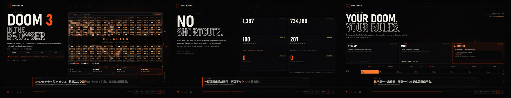

# DOOM3_AINative — three-poster product concept

**One offline HTML file. Three posters. A browser-monitor product hero, a real (redacted) DOOM 3 frame, and a one-sentence Rogue-mode concept.**

Open [`index.html`](index.html) directly, or double-click [`start.cmd`](start.cmd) for a full-screen
Microsoft Edge kiosk with the autoplay exemption.



## What the deck says

| Poster | Claim | What it shows |
|---|---|---|
| **01 · PLAY** | *DOOM 3 in the browser.* | A monitor/browser mockup with a **real DOOM 3 frame, fully redacted in `XX`**, a live HUD, and four capability cards: **PLAY / REMAP / MOD / AI ROGUE**. |
| **02 · WHY IT'S REAL** | *No shortcuts.* | Six measured facts from `docs/ROADMAP.md` §1: 1,387 C/C++ files, 734,180 lines, 100 fixed-function calls, 207 ARB references, 0 pak archives, 0 Emscripten references. |
| **03 · VISION** | *Your DOOM. Your rules.* | **REMAP** (M5 planned), **MOD** (M7 planned), and **AI ROGUE** — a working concept demo where one sentence regenerates a seed, a map and a modifier. Plus the seven-step delivery loop and the M0–M7 roadmap. |

The deck is a **product concept**, not a claim that the port is shipped. Poster 1 uses future-tense
product copy (`will run`), carries `M0 · SCAFFOLD`, and says port work starts at M1; poster 3
labels the roadmap `CONCEPT ROADMAP / 2026`, and the AI Rogue panel says
`CONCEPT DEMO · NOT A SHIPPED FEATURE`.

## The redacted capture

The real frame in the monitor is a **heavily redacted** derivative of an official DOOM 3
promotional screenshot from the Steam store page (app 9050, © id Software / Bethesda / ZeniMax).
No reuse licence is granted. The original screenshot is **not** in this repository.

The committed `assets/hero-redacted.png` is:

- cropped to 16:9, downscaled to 48×27 and re-expanded with nearest-neighbour (deliberate mosaic);
- ember-graded, darkened and vignetted;
- covered by a full-frame **56×30 `XX` grid**;
- stamped `REDACTED` / `LICENSING PENDING · NOT A LICENSED RELEASE`;
- finished with scanlines.

It preserves the shape of a real frame while removing readable art. It is a **placeholder**, not a
licensed release. See [`assets/README.md`](assets/README.md). Replace it with a licensed capture
before public distribution:

```powershell
uv run --python 3.12 showcase/build.py `
  --hero "..\captures\licensed-frame.png" `
  --hero-label "LICENSED CAPTURE" `
  --hero-credit "Capture: your name / used with permission"
```

A local, unredacted design preview was used only in the operator's temp directory and is not part of
this repository. The rejected alternatives (Doom Wiki fair use, CC BY 2.0 QuakeCon photo, CC BY-SA
2.5 fan art) are not GPL-compatible; the licence audit is recorded in the project conversation.

## Controls

| Input | Action |
|---|---|
| `←` / `→` or swipe | Previous / next poster |
| `Space` | Pause / resume |
| `M` | Mute / unmute |
| `C` | Toggle captions |
| `F` | Fullscreen |
| `GENERATE RUN` (poster 3) | Regenerate the AI Rogue concept prompt, seed, map and modifier |
| Bottom bar | Prev, play/pause, next, sound, captions, fullscreen |

The deck auto-advances when a poster's narration ends and loops from poster 3 to poster 1. If the
browser blocks autoplay, it falls back to a silent wall-clock rotation with captions and shows a
**CLICK FOR SOUND** button; one click restores audio from the current poster without reloading.

### Query parameters

| Parameter | Effect |
|---|---|
| `?page=1\|2\|3` | Start on a specific poster |
| `?snap=1` | Settle all entrance transitions and freeze the canvas — used for screenshots |
| `?mute=1` | Start muted (captions still advance) |
| `?autoplay=0` | Start paused |
| `?cc=0` | Start with captions hidden |

## Kiosk launch

```powershell
.\showcase\start.cmd
```

`start.cmd` resolves its own directory, starts Edge with `--kiosk`, sets
`--autoplay-policy=no-user-gesture-required`, and keeps a local `edge-profile/` (git-ignored). Exit
kiosk with `Alt+F4`. Do not point it at a network URL: the deck is designed to run from `file://`.

## Narration

Voice: `zh-CN-YunxiNeural`, rate `+8%`. Total: about **74.3 seconds**.

**01 · PLAY**

> 想象一下，打开一个网页，DOOM 3 就在里面跑。不用安装，不用云游戏，不用模拟器。WebAssembly 和 WebGL2，把二〇〇四年的 idTech4 引擎，直接搬进浏览器。鼠标锁定，手柄，改键，Mod，全部在网页里。这，就是 DOOM3_AINative。我们正在把它变成现实。

**02 · WHY IT'S REAL**

> 先看现实。一千三百八十七个 C/C++ 文件，七十三万四千一百八十行代码。一百处固定管线调用，两百零七个 ARB 着色器。仓库里没有一个 pak 资源包。也没有一行 Emscripten。这不是打开一个编译开关。而是重写渲染器、文件系统、输入和主循环。

**03 · VISION**

> 改键，Mod，AI 一句话生成 Rogue 模式。一句话，生成地图、规则和敌人。这不是一个启动器，而是一个 AI 原生的游戏平台。一个议题，一个分支，一个工作树，一个 PR。规格、实现、独立审查、证据门禁。从 M0 到 M7，每一步都由证据推进。目标，是让 DOOM 3 在浏览器里重生。

The English translation is the second caption line. Both live in
[`src/narration.json`](src/narration.json).

## Rebuild

The committed `index.html` already contains the audio and the redacted capture. Rebuilding is only
needed when the script, voice, redacted asset, or licensed media changes.

```powershell
uv run --python 3.12 showcase/build.py
```

By default the build uses `assets/hero-redacted.png`. Use `--no-hero` for the procedural industrial
reference frame, or `--hero` for a licensed image/video. The first build needs network access to
Microsoft Edge TTS; later builds reuse the git-ignored cache in
`showcase/evidence/tts-cache.json`.

```text
showcase/
├── index.html                 generated single-file deliverable
├── assets/
│   ├── hero-redacted.png      redacted real frame (placeholder, licensing pending)
│   └── README.md              provenance + redaction method
├── src/
│   ├── narration.json         the only transcript source
│   ├── head.html              document head + meta
│   ├── base.css               tokens, chrome, captions, controls
│   ├── posters.css            poster 1/2/3 layouts
│   ├── body.html              DOM
│   ├── runtime.frame.js       procedural industrial reference frame (fallback)
│   ├── runtime.canvas.js      portal / code rain / workflow graph
│   └── runtime.core.js        audio, clock, captions, controls, AI Rogue demo
├── build.py                   TTS + timings + assembly + hero media
├── verify.py                  Playwright contract gate
├── verify_deep.py             extended matrix (Chrome/Edge, offline, touch, sync)
├── start.cmd                  Edge kiosk launcher
└── preview.png                3-up preview for this README
```

**Do not hand-edit `index.html`.** Change `src/` or the asset and rebuild.

## Verification

```powershell
uv run --python 3.12 showcase/verify.py
uv run --python 3.12 showcase/verify_deep.py
```

Current evidence (2026-10-26):

- `verify.py` — **102 passed, 0 failed**. Single file 1.61 MiB, zero external requests, three posters,
  zero console/page errors, three distinct screenshots, embedded narration, six claim literals,
  redacted-hero label, four capability cards, AI Rogue concept, keyboard/pause/captions,
  autoplay-blocked fallback, `?autoplay=0`, 1366 scaling.
- `verify_deep.py` — **151 passed, 0 failed, 1 skipped**. Edge + Chrome, offline `file://`, reduced
  motion, `cc=0`, **real CDP touch swipe (no `pointercancel`)**, 3→1 loop, caption + word sync at all
  20 chunks, Space-on-control, page visibility, canvas-unavailable fallback, evidence hovers, mute,
  fullscreen, 4K + DPR2, portrait, animation, **56–60 fps measured across runs** (56.3 conservative; gate ≥30), accessible button
  names, HTML parse, and the `start.cmd` contract. The one skip is Firefox: not installed.
- **axe-core 4.10.3, WCAG 2.1 A/AA** — **0 violations** on all three posters after a 900 ms settle;
  **1 incomplete color-contrast check per poster** (120/88/111 nodes, text over image/canvas), so AA
  contrast is not fully machine-verified. The first pass exposed two real contrast misses, both fixed.
- **Reproducibility** — two consecutive default builds are byte-identical: 1,688,020 bytes,
  SHA-256 `9586a7a8288e925ee57803031de22d19144f038952f742657f7ac919dcb5aa28`.

Screenshots and logs land in `showcase/evidence/`, which is git-ignored. `verify.py --headed` lets
you watch the run.

## Facts and sources

Every number on poster 2 comes from [`docs/ROADMAP.md`](../docs/ROADMAP.md) §1, evidence captured
2026-10-26 from the pristine submodule at `a9c49da5`. The workflow wording comes from
[`docs/GIT_WORKFLOW.md`](../docs/GIT_WORKFLOW.md) and [`AGENTS.md`](../AGENTS.md). If the roadmap
numbers change, update `showcase/src/body.html` and run the verifier: it asserts the literals.

## Licensing

- This repository's content is **GPL-3.0-or-later**.
- DOOM 3 engine source is GPLv3; game data is **not** included and remains under the original EULA.
- DOOM 3 is a trademark of id Software / ZeniMax. This project is unaffiliated.
- `assets/hero-redacted.png` is a transformed derivative of an official promotional screenshot.
  Rights remain with id/Bethesda; it is included only as a **redacted placeholder** with
  `LICENSING PENDING`. Replace it with a licensed capture before public distribution. The original
  screenshot is not in this repository.
- The procedural reference frame, portal, code rain, graph and AI Rogue demo are original code in
  this repository.
- Narration is generated with Microsoft Edge TTS from the repository's own script.
- Any `--hero` image or video is supplied by the operator; it is inlined into a local build but is
  not part of the repository, and the operator is responsible for its licence.
